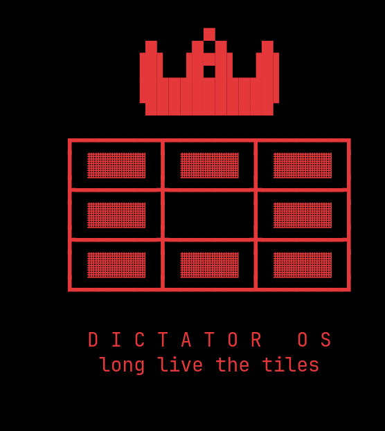
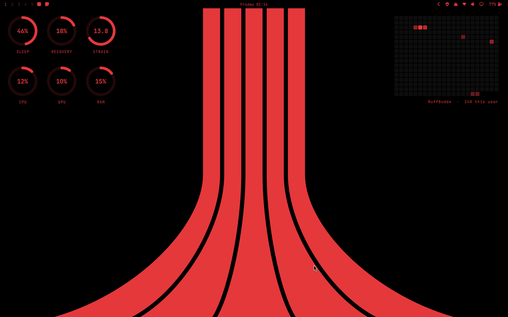
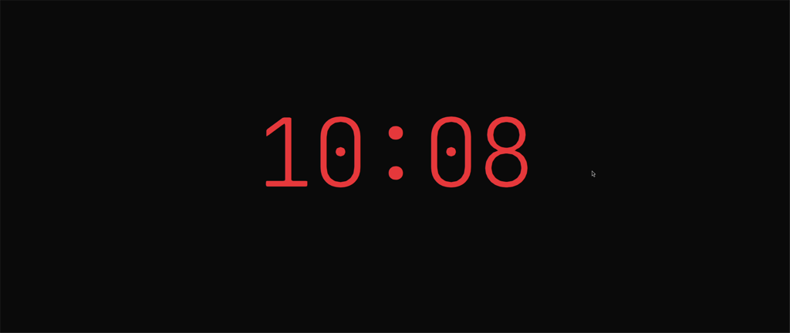
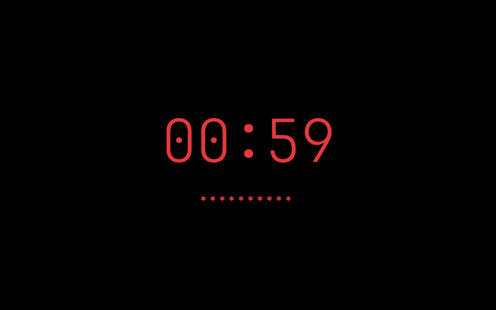
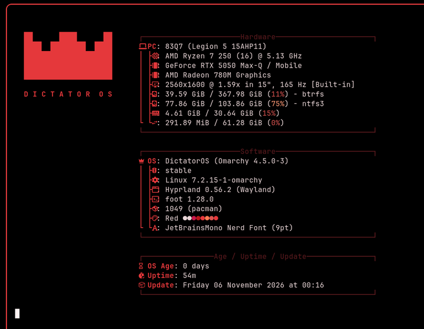
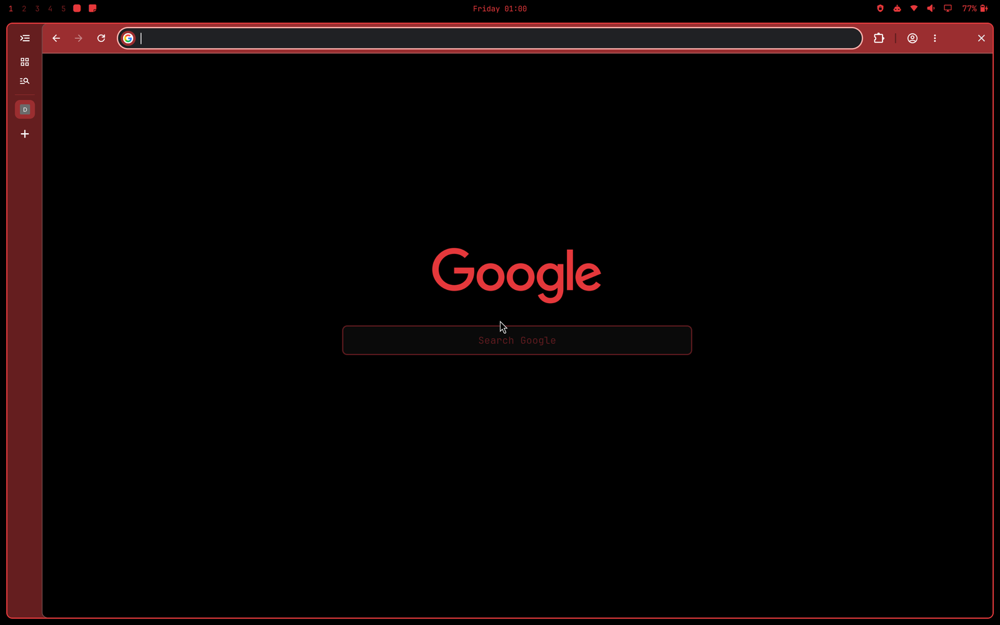
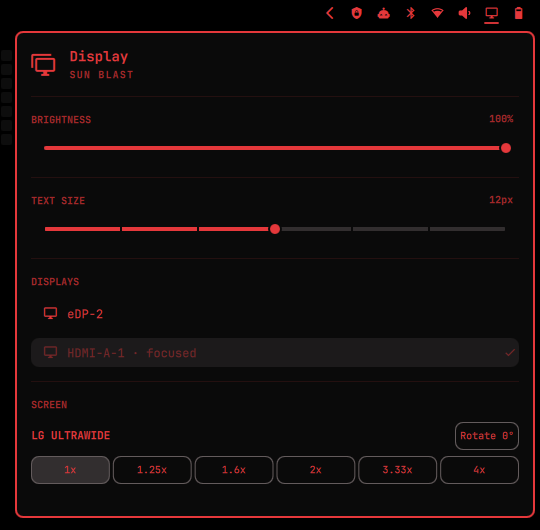

<p align="center"></p>

<h1 align="center">DictatorOS</h1>

 -e5383b?style=flat-square&labelColor=0a0a0a)     

> **By decree: an [Omarchy](https://omarchy.org) setup that takes no suggestions.** Windows
> tile or face the consequences. The flag is red and black. One desktop spans every screen,
> the lock screen asks only for your password, the widgets report directly to the Leader, and
> no Omarchy update may change a single dotfile without signed approval.

## The Manifesto

> *Citizens of the desktop,*
>
> You may have read another manifesto on your way here. A long one. It explained, in the
> tone usually reserved for wine lists and keynotes, that your computer is *omakase*: the
> chef has chosen everything for you, the chef has strong feelings about your editor, and
> the chef would like you to know that this is, in fact, a love letter. We admire the
> confidence. We have simply removed the chef.
>
> For too long you have lived under the tyranny of choice: windows drifting wherever
> they pleased, colours of every stripe, apps seizing your focus without warning. That era
> is over. By order of the Supreme Leader of this laptop, the following decrees take
> effect immediately.
>
> 1. **Windows shall tile.** Floating is treason. Installer terminals, task monitors and
>    games alike shall stand in line, side by side or one above the other (Super+arrows).
> 2. **There is one desktop.** Screens that try to show different workspaces will be
>    re-educated, and a screen that leaves will have its windows returned to the motherland.
> 3. **The colours of the state are red and black.** All other colours are confiscated.
>    Terminals are black, the bar is black, and transparency has been abolished.
> 4. **The banner of the state is shown only to the idle.** Where citizens work, there is
>    black; on an empty desktop the red stripes are drawn up from the ground.
> 5. **No application may seize your attention.** Focus belongs to the people, and a
>    notification has five seconds to say its piece.
> 6. **The bar stands watch** over every screen. Super+B dismisses it when the Leader
>    wishes to be alone.
> 7. **Updates may petition; they may not decree.** Every change an update attempts is
>    detained as a patch and awaits the Leader's approval.
> 8. **The battery shall rest at 80 percent**, for the long-term health of the nation.
>    A bolt marks the hours it spends at the national grid.
> 9. **The state does not sleep.** Closing the lid changes nothing.
> 10. **One face guards every gate.** Lock screen and login wear the same thin red clock;
>     at boot, where no clock may go, red stars stand in its place. You type; it opens.
> 11. **The border lists only recognised territories:** DictatorOS and any Windows that
>     has sworn allegiance. History (snapshots) is not to be revisited from the boot menu.
> 12. **The browser wears the uniform.** AI Mode, Gemini and Lens are exiled; the new tab
>     page shows only the red wave; citizens search from the address bar.
> 13. **Alt+Tab is a fundamental right**, as are Win+D, Win+E, Win+P and Ctrl+Shift+Esc.
> 14. **Opinions are mandatory, and they are ours.** Upstream's opinions may petition like
>     any other update (see decree 7). They will be read, eventually, and framed, never.
> 15. **Manifestos shall be short.** This one is shorter than Omarchy's. That is also a decree.
> 16. **Political discussion is banned on this machine.** We did not invent this policy; we
>     found it in the chef's other restaurant, where it was served to the staff in 2021.
>     It is the one recipe of his we kept, and the only one that suits a dictatorship.
>
> Long live the tiles.
>
> *(Signed in red ink, RuffBudda, Supreme Leader)*

## Screenshots

| Desktop: idle, so the stripes are allowed | Lock screen |
|---|---|
|  |  |
| *Sleep / recovery / strain and CPU / GPU / RAM rings, a year of GitHub days, black bar with battery %* | *Type your password; it unlocks when it's complete* |

<p align="center"><br><em>Login screen: same clock and stars as the lock screen</em></p>

<p align="center"><br><em><code>fetch</code>: the crown builds itself, then the info appears</em></p>

<p align="center"><br><em>Chromium: red accents and tabs on the left</em></p>

<p align="center"><br><em>Bar monitor panel: brightness, text size, screens, per-screen scale and rotation</em></p>

> Built on Omarchy 4.5 (Hyprland 0.56, Lua config) on a Lenovo Legion 5 15AHP11
> (AMD + NVIDIA). Most of it works on any Omarchy 4.5 machine; the hardware bits
> (battery limit, Bluetooth fix) are Lenovo-specific.

---

## Contents

- [The Manifesto](#the-manifesto)
- [Screenshots](#screenshots)
- [Highlights](#highlights)
- [Requirements](#requirements)
- [Install](#install)
- [Keyboard shortcuts](#keyboard-shortcuts)
- [Features in detail](#features-in-detail)
- [How updates are handled](#how-updates-are-handled)
- [Customising](#customising)
- [Undoing / uninstalling](#undoing--uninstalling)
- [Repository layout](#repository-layout)
- [Third-party plugins](#third-party-plugins)
- [Credits and license](#credits-and-license)

---

## Highlights

- **Windows-style shortcuts**: Alt+Tab switcher with live thumbnails, Win+P project
  menu, Win+D show desktop, Win+E files, Win+L lock, Ctrl+Shift+Esc Task Manager,
  Win+Shift+S screenshots.
- **One desktop across all monitors**: Super+1…0 switches every screen together;
  unplugging or re-plugging a monitor keeps windows where they belong.
- **Tiling only**: no floating popups layered over your work (installer terminals,
  btop, Steam… all tile); Super+Left/Right snaps a lone window to half the screen
  without floating it; Super+Up/Down stacks windows vertically (or snaps a lone window
  to the top/bottom half). Omarchy's Super+T (toggle floating) is unbound.
- **Black + red**: custom *Red* theme, red-stripes-on-black wallpaper, no logos on boot,
  login or lock screens, rounded corners everywhere. The Limine boot menu is red on black
  too, with DictatorOS and any Windows installs.
- **Chromium to match**: red-accented toolbar, tabs down the left side, and a black
  new tab page that is just a red wave (search from the address bar). No bookmarks bar, no
  AI Mode / Gemini / Lens.
- **Minimal lock screen**: a big thin red clock; type your password and it unlocks
  as soon as it's complete (no Enter). The login and disk-unlock screens look the same.
- **Desktop widgets**: WHOOP sleep/recovery/strain rings, live CPU/GPU/RAM rings and a
  year of GitHub days, sitting on the wallpaper behind your windows.
- **Wallpaper only when idle**: hidden (black) while a desktop has windows, drawn up from
  the bottom when it's empty.
- **Black bar**: shown by default, Super+B hides it; solid black with red icons and a
  battery percentage (bolt while plugged in). Monitor panel with a built-in screen arranger, per-screen scale and
  rotation.
- **Update-proof**: after every `omarchy update`, your settings are restored and any
  changes the update wanted are saved as a patch for you to approve. System tweaks
  re-apply themselves automatically.

## Requirements

- **Omarchy 4.5** (Arch Linux, Hyprland with the Lua config, Omarchy shell).
- The repo **must be cloned to `~/dotfiles`**: scripts and bindings refer to that path.
- Packages (official Arch repos):
  `ttf-jetbrains-mono mission-center nwg-displays openvpn networkmanager-openvpn`
- Optional:
  - [`gh`](https://cli.github.com) signed in, for the GitHub graph widget.
  - A WHOOP account and developer app, for the WHOOP rings plugin
    ([OmaWhoop](https://github.com/RuffBudda/OmaWhoop), see [Desktop widgets](#desktop-widgets)).
  - `gnome-network-displays` (AUR; a patched build is included) for wireless casting.

## Install

```bash
git clone https://github.com/RuffBudda/DictatorOS.git ~/dotfiles
~/dotfiles/install.sh                 # user config (safe to re-run)
sudo ~/dotfiles/system/install.sh     # system tweaks (safe to re-run)
sudo pacman -S --needed ttf-jetbrains-mono mission-center nwg-displays openvpn networkmanager-openvpn
omarchy theme set red
```

**`install.sh`** (no root) links these into place, backing up anything it replaces as
`<file>.bak.<timestamp>`, then reloads Hyprland:

- `hypr/` → `~/.config/hypr/` (bindings, desktops, tiling, monitors, input, look and feel, screen-share picker)
- `omarchy/shell.json`, `omarchy/plugins/abu.*`, `omarchy/themes/red`, `omarchy/hooks/…`, `omarchy/branding/…` → `~/.config/omarchy/`
- `applications/*.desktop` → `~/.local/share/applications/`
- `fastfetch/config.jsonc` → `~/.config/fastfetch/`; `bin/fetch` → `~/.local/bin/fetch` and `~/.local/bin/neofetch`

It also edits `~/.config/chromium-flags.conf` (vertical tabs, the `chromium/blank-newtab`
new tab page, no yt-dlp extension) and, while Chromium is closed, turns vertical tabs on
in its profile.

**`system/install.sh`** (root). Each step is idempotent:

1. Limine boot menu, red on black with a 10 s countdown. Entries: **DictatorOS**, plus an
   entry for each Windows install, added only if its partition exists. DictatorOS is a single line
   (no kernel tree): `system/limine-flatten`, also installed as a limine-entry-tool post
   hook (`/etc/boot/hooks/post.d/`) so kernel updates keep it flat. No Snapshots submenu:
   Snapper still takes snapshots and still runs `limine-snapper-sync` (from its hourly
   cleanup and its plugin), but that runs the same hook, which strips the submenu again. Limine is put first
   in the firmware boot order. To hide the menu:
   `sudo BOOT_MENU=hidden BOOT_TIMEOUT=1 ~/dotfiles/system/install.sh`.
2. Black Plymouth boot splash with no logo; the disk-unlock screen says "enter password"
   in dim red, then shows red ✱ stars as you type (no box), like the lock screen.
3. SDDM login screen like the lock screen: thin red clock, red stars, no box.
4. Chromium policies: YouTube notifications blocked, Claude extension installed,
   no bookmarks bar / home / cast buttons or new-tab cards, AI Mode, Gemini and Lens off.
5. Battery: Lenovo *Conservation mode* (charging stops at about 80 %), re-applied on boot.
   The udev rule fires on `add` only: writing `charge_types` emits a `change` event, so
   matching `change` loops (~700 events/s, udev and upowerd pinned, Wi-Fi throughput halved).
6. No automatic sleep: closing the lid does nothing (battery or AC).
   6b. Miracast: ufw opens DHCP, DNS and RTSP (TCP 7236) to the Wi-Fi Direct link only
   (`10.42.0.0/16`), so a TV can get an address and connect back for the stream.
7. A pacman hook that re-applies all of the above after relevant package updates.
   It runs a root-owned copy of the script, never the user-writable one.

Then the app choices and, optionally, the WHOOP rings plugin:

```bash
~/dotfiles/apps.sh                    # apps, fonts, removals (asks for sudo; safe to re-run)
omarchy plugin add https://github.com/RuffBudda/OmaWhoop.git --enable --yes
~/.config/omarchy/plugins/ruffbudda.whoop/scripts/whoop-auth   # connect WHOOP once (rings appear)
```

**`apps.sh`** (asks for sudo):

- **Adds** Claude Desktop, Obsidian, fwupd, Office-compatible fonts (Carlito for Calibri, Caladea
  for Cambria, Liberation/Croscore for Arial, Times New Roman and Courier New) and about 35
  common font families from the Arch repos, plus ~30 more Google Fonts (Poppins,
  Raleway, Playfair Display, Merriweather, Lora, DM Sans…) into `~/.local/share/fonts/google`.
- **Web apps**: keeps WhatsApp and Zoom; adds Outlook, Outlook Calendar and Teams;
  removes Basecamp, X, Discord, HEY, the Google web apps and the Office web apps.
- **Removes** apps this setup doesn't use: Pinta, Kdenlive, OBS, Xournal++,
  cliamp, Aether, Moonlight, LocalSend, Gliff, Superwhisper (and its leftovers), owe,
  Disktree, Evince, yt-dlp, tobi-try, lazygit, ttfx, .NET, Ruby, the
  MariaDB/PostgreSQL client libraries, the Chinese/Japanese/Korean input add-ons
  (the fcitx5 core stays: Omarchy uses it for compose keys), asdcontrol,
  qemu-user-static-binfmt, and `intel-ucode` on AMD machines only.
  Edit `REMOVE_PKGS` at the top to keep any of them.
- **rmdesk**: clones it to `~/Work/rmdesk` and builds its Python environment.

### Dual boot with Windows: keep Limine first

Windows moves its own boot manager to the top of the firmware boot order every time it
starts, so the next restart skips Limine (re-ordering in the BIOS doesn't stick). Run this
once in **each** Windows install, in PowerShell **as Administrator**:

```powershell
irm https://raw.githubusercontent.com/RuffBudda/DictatorOS/main/windows/install-limine-first.ps1 | iex
```

It adds a startup task that puts Limine back on top whenever Windows boots
(`windows/limine-first.ps1`). Undo: `schtasks /delete /tn "DictatorOS Limine first" /f`.
On the Linux side, `system/install.sh` adds `dotfiles-limine-first.service`, which does the
same check at every Linux boot.

Keep machines in sync with `git -C ~/dotfiles pull` (and commit + push your own changes).

## Keyboard shortcuts

Only the shortcuts that differ from Omarchy's defaults. Full list: `omarchy menu keybindings --print`.

| Keys | Action |
|---|---|
| **Alt+Tab** / Alt+Shift+Tab | Switcher with thumbnails of the windows on the current desktop (all screens). Hold Alt, tap Tab, release to switch; Esc cancels |
| **Super+1…0** | Switch desktop (every screen switches together) |
| **Super+Shift+1…0** | Move window to that desktop (same screen) |
| **Super+Tab** | Next desktop that has windows |
| **Super+Shift+N** | Move window to the first empty desktop |
| **Super+D** | Show desktop (hide all windows on all screens); again to bring them back |
| **Super+Left / Right** | Lone window: snap to the left/right half (stays tiled). With others: move left/right. At the screen edge: move to the next/previous screen, wherever it sits |
| **Super+Up / Down** | Lone window: snap to the top/bottom half. Side-by-side windows: stack them vertically (this one on top for Up, at the bottom for Down). Stacked: move up/down |
| **Super+L** | Lock screen |
| **Super+E** | Files |
| **Ctrl+Shift+Esc** | Task Manager (Mission Center). btop is Super+Shift+T |
| **Super+Shift+S** | Screenshot of a region |
| **Super+P** | Project menu: PC screen only / Duplicate / Extend / Second screen only / Cast to a wireless display… / Display settings… |
| **Super+N** | Cast to a wireless display (Miracast / Chromecast) |
| **Super+B** | Hide / show the top bar (shown by default) |
| **Super+M** | Sticky notes panel |

## Features in detail

### Windows and desktops

- **Desktops span monitors** (`hypr/desktops.lua`): desktop *N* is workspace *N* on the
  laptop, *N+10* on the second screen, *N+20* on a third. The bar and Alt+Tab show
  desktops, not per-screen workspaces. Unplugging a monitor merges its windows into the
  same desktop on the laptop; plugging it back in sends workspaces home.
- **Tiling only** (`hypr/tiling.lua`): windows Omarchy floats by default tile instead.
  File pickers and save dialogs still float.
- **No focus stealing**: an app asking for attention (for example a terminal finishing a
  task) doesn't pull you to its workspace (`focus_on_activate = false`).
- **Windows stay with their launcher** (`hypr/contain.lua`): a window opened by an app on
  another workspace (say Claude in a terminal on desktop 1 opens an image viewer while
  you're on desktop 2) opens on the launcher's workspace, without pulling you there. It
  matches the new window's systemd scope (cgroup) to the windows already in it, so it
  still works for detached / backgrounded processes. Launcher and keybinding apps, a
  new window of an already-running app (terminal, Chromium) and ambiguous cases open
  where you are, as usual. A link opened in an already-running Chromium is just a tab in
  its existing window, so that isn't moved.
- **Desktop indicator**: a small red number tile top-right for 1.5 s when you switch
  desktops, only while the bar is hidden.

### Lock, login and boot

- **Lock screen** (`omarchy/plugins/abu.lock`): plain black (no wallpaper), thin red clock, red ✱ stars as you type,
  no box. After one successful unlock it remembers your password **length** (never the
  password; file mode 600) and unlocks as soon as you've typed that many characters.
  A failed automatic attempt turns this off for that lock (for example after a password
  change). The password field only shows on the main screen.
- **Screen stays on while locked on AC power**; on battery it turns off after 5 s.
- **Idle**: no screensaver, no automatic lock, no automatic sleep.
- **Login screen** (SDDM, after logout): the same thin red clock and red stars; press Enter.
- **Disk unlock at boot** (Plymouth): black, "enter password" in dim red until you type,
  then red stars centred, no box (no clock: Plymouth scripts can't read the time).
- **Boot menu** (Limine): 10 s countdown, red on black, "DictatorOS" title. Choose
  DictatorOS or Windows. Snapshots are not listed.
- **Admin password prompts** use Omarchy's standard dialog.

### Chromium

- **Colours**: `omarchy/themes/red/chromium.theme` gives Chromium the red accent, so the
  toolbar, tab strip and focus outlines are red (no Chromium blue).
- **Tabs down the left side** (vertical tabs).
- **New tab page** (`chromium/blank-newtab`, loaded with `--load-extension`): only the
  DictatorOS red wave (`wallpaper.svg` / `.png`), no logo or search box; search from the
  address bar. A small background
  script also replaces Chromium's own page in the first tab after start-up.
- **Policies** (`system/install.sh`): Claude extension, no bookmarks bar, home or cast
  buttons, no new-tab cards, AI Mode / Gemini / Lens off, YouTube notifications blocked.

### Bar and panels

- Hidden by default (**Super+B**); transparent with red icons; pushes windows down while
  shown. Auto-hide is built in but off (`autoHide` in `abu.bar/Bar.qml`).
- **Monitor panel** (`abu.monitor`): brightness, text size, a drag-to-arrange screen map,
  and per-screen scale and rotation. Backend: `bin/monitor-layout` writes `hypr/displays.lua`.
- **Notifications** get a ✕ close button.
- **VPN panel** (`abu.openvpn`): OpenVPN profiles, plus **Sign in to a VPN…** with server,
  username and password like the OpenVPN Connect app (downloads your profile from
  OpenVPN Access Server), or enter details manually (`bin/vpn-signin`, `bin/vpn-new`).
- **Sticky notes** (`abu.stickynotes`, Super+M): a bento board of notes in a bar panel.

### Desktop widgets

On the wallpaper layer, behind windows: see them on an empty desktop or with Super+D.
Spacing matches window gaps, and they sit below the bar when it's shown.

- **Top-left: WHOOP** Sleep %, Recovery % and Strain (0–21) rings, refreshed every 15 min.
  This is a separate plugin, [OmaWhoop](https://github.com/RuffBudda/OmaWhoop) (`ruffbudda.whoop`),
  installed from its own repo (see [Third-party plugins](#third-party-plugins)). One-time setup:
  1. Create an app at <https://developer-dashboard.whoop.com> with redirect URI
     `http://localhost:8765/callback` and scopes `read:recovery read:cycles read:sleep offline`.
  2. Run `~/.config/omarchy/plugins/ruffbudda.whoop/scripts/whoop-auth`, paste the Client ID
     and Secret, approve in the browser.

  Keys live in `~/.config/whoop/` (mode 600), never in this repo. Without the plugin, the
  CPU / GPU / RAM box moves up into the corner.
- **Top-left, below: CPU / GPU / RAM** rings every 3 s (`bin/sysstats`). GPU shows the busier
  of the AMD iGPU and the NVIDIA card; the NVIDIA card is only read while it's already awake.
- **Top-right: GitHub** contribution graph in red, every 30 min, from the signed-in `gh`
  account (`bin/github-contrib`).

### Displays, casting and screen sharing

- **Super+P** project menu, and **Display settings…** (nwg-displays, writing `hypr/displays.lua`).
- **Super+N** casting through GNOME Network Displays' background service, in the same
  menu style (also **Super+P → Cast to a wireless display…**, like Windows' Win+P).
  Miracast runs over Wi-Fi Direct (NetworkManager + wpa_supplicant + dnsmasq); the
  firewall rules it needs are `system/install.sh` step 6b. `packages/gnome-network-displays` builds a patched version that doesn't
  crash on close.
- **Screen-share picker** (`bin/share-picker`): a simple menu of screens, windows and
  "Select a region" instead of the thumbnail window.

### `fetch` / `neofetch`

`fastfetch/config.jsonc` + `fastfetch/logo.txt`: system info reads **DictatorOS (Omarchy x.y)** in red,
with the DictatorOS logo: a crown made of tiles over the name. `fetch` and `neofetch`
(`bin/fetch`, linked into `~/.local/bin`) both run it; neofetch itself is discontinued.
In a terminal the crown is built first (rows rise from the bottom, then the name types
out, ~0.7 s) and fastfetch prints the info beside it. `FETCH_NO_ANIM=1` skips that.

### Obsidian: Ask the Vault

`obsidian/vault-ask/` is a small Obsidian plugin (no third-party code):

- **Side chat with local AI.** The red **✦ Ask vault** button in the status bar (or the bot
  icon in the left ribbon, or the command "Open side chat") opens a chat in the right
  sidebar. Answers **stream in as they're written**, come **only from your vault** (local
  models through [Ollama](https://ollama.com), nothing leaves the machine), and link the
  notes they used. If the notes don't cover the question it says so instead of guessing.
  Follow-up questions work; **Stop** halts an answer, **New chat** starts over.
- **Link selection to a note or an H2.** Select text, then right-click → **Link selection
  to…** (or Ctrl+Shift+L): pick a note, or a specific `##` heading in any note, and the
  selection becomes `[[Note#Heading|selected text]]`.

Setup and details:

- Needs Ollama running with `qwen3:8b` (answers) and `nomic-embed-text` (search):
  `sudo pacman -S ollama-cuda && sudo systemctl enable --now ollama && ollama pull qwen3:8b && ollama pull nomic-embed-text`
  (and `OLLAMA_ORIGINS=app://obsidian.md*` for the streaming chat, set in
  `/etc/systemd/system/ollama.service.d/obsidian.conf`).
- `install.sh` links it into every Obsidian vault and enables it.
- Notes are indexed the first time you ask and only changed notes are re-indexed after
  that. The index is stored in the plugin's `data.json`, which is git-ignored because it
  contains note text.
- Models and the Ollama address can be changed in Settings → Ask the Vault.

### Theme

`omarchy/themes/red`: black backgrounds, red accents, red icon set, transparent bar with
red icons, red lock screen. The wallpaper is forced to solid black on every theme change.

Colour codes, from `omarchy/themes/red/colors.toml` (the bar, borders, terminal, menus and
lock screen are all generated from it):

| | Group | Name | Hex |
|---|---|---|---|
|  | Accents | `accent` | `#e5383b` |
|  | Accents | `selection` | `#3a0d10` |
|  | Accents | `muted` | `#5c1a1e` |
|  | Backgrounds | `background` | `#000000` |
|  | Backgrounds | `dark_background` | `#050505` |
|  | Backgrounds | `darker_background` | `#000000` |
|  | Backgrounds | `lighter_background` | `#161011` |
|  | Text | `foreground` | `#e8d5d6` |
|  | Text | `dark_foreground` | `#8a5a5d` |
|  | Text | `light_foreground` | `#f0e0e1` |
|  | Text | `bright_foreground` | `#fff2f2` |

Terminal colours. All reds and red-oranges, even the ones named after other colours
(`orange` and `brown` have no bright variant):

| Name | Normal | Hex | Bright | Hex |
|---|---|---|---|---|
| `red` |  | `#e5383b` |  | `#ff4d4f` |
| `yellow` |  | `#ff7b54` |  | `#ff9a76` |
| `orange` |  | `#ff5a36` | — | — |
| `green` |  | `#d9534f` |  | `#f26a6d` |
| `cyan` |  | `#c9184a` |  | `#ff4d6d` |
| `blue` |  | `#e5383b` |  | `#ff595e` |
| `magenta` |  | `#ba181b` |  | `#e01e37` |
| `brown` |  | `#660708` | — | — |

### Hardware (Lenovo Legion)

- `system/install.sh` step 5: battery Conservation mode via `charge_types = Long_Life`.
- `system/bluetooth-rtl8852bd.sh`: Bluetooth for the Realtek RTL8852BD (patched `btrtl`
  via DKMS plus firmware from Lenovo's Windows driver, re-applied after kernel updates).

### Other

- **Notifications** hide after 5 s, urgent ones included (they stay in the history).
- `apps.sh`: app choices (fonts, removals, Claude Desktop, fwupd, web apps, rmdesk;
  see [Install](#install)).
- `bin/rmdesk` + launcher: a reMarkable 2 desktop app (separate project with its own venv).
- `bin/block-text`: render text in the Omarchy logo's block-letter style.
- `preview/`: HTML mock-ups used while designing the lock screen.

## How updates are handled

Omarchy updates can't change your setup without your approval:

1. **Your settings**: after every `omarchy update`, `bin/dotfiles-check` (an Omarchy
   post-update hook) re-links the dotfiles. If the update edited them, the edits are saved
   to `updates/*.patch` (git-ignored, local only), your version is restored, and you get a
   notification. Apply a suggestion you like with `git -C ~/dotfiles apply updates/<file>.patch`.
2. **System tweaks**: the pacman hook from `system/install.sh` re-applies the boot splash,
   login screen, YouTube block, battery limit and lid setting after relevant updates.
3. **Health checks**: the post-update check also warns about Hyprland config errors,
   custom widgets that fail to load, and the unpatched Network Displays coming back.

Run the check any time: `~/dotfiles/bin/dotfiles-check`.

## Customising

Edit files in `~/dotfiles` (the ones in `~/.config` are symlinks), then:

| You edited | Apply with |
|---|---|
| `hypr/*.lua` | applied on save; check `hyprctl configerrors` |
| `omarchy/plugins/*` | `omarchy restart shell` |
| `omarchy/themes/red/*` | `omarchy theme set red` |
| `system/install.sh` | `sudo ~/dotfiles/system/install.sh` (also refreshes the hook's root-owned copy) |

Common tweaks:

- Lock screen back to a boxed field: set `clockStyle: false` in `abu.lock/LockView.qml`.
- A name above the lock screen password: `bin/block-text YOUR NAME > omarchy/plugins/abu.lock/name-art.txt`.
- Show the boot menu longer, or never: `sudo BOOT_TIMEOUT=3 ~/dotfiles/system/install.sh` (or `0`).
- Auto-lock again: set `idle.lock` (in seconds) in `omarchy/shell.json`.

## Undoing / uninstalling

- Each linked file's original was saved as `<file>.bak.<timestamp>` next to it: remove the
  symlink and rename the backup back.
- `omarchy refresh hyprland` and `omarchy refresh shell` reset to Omarchy's defaults.
- System tweaks: delete `/etc/pacman.d/hooks/zz-dotfiles-system.hook`,
  `/etc/sddm.conf.d/zz-dotfiles.conf`, `/etc/systemd/logind.conf.d/dotfiles-lid.conf`,
  `/etc/udev/rules.d/90-dotfiles-battery.rules` and
  `/etc/chromium/policies/managed/{dotfiles,claude,minimal}.json`, then run
  `sudo plymouth-set-default-theme omarchy && sudo limine-mkinitcpio`. The Limine
  colours and entry name are restored from `/boot/limine.conf.bak.<timestamp>`; also
  remove `TARGET_OS_NAME` from `/etc/default/limine`, and
  `sudo systemctl enable --now limine-snapper-sync` to bring back boot-menu snapshots.
- Chromium: remove the `blank-newtab` path and `VerticalTabs` from
  `~/.config/chromium-flags.conf`.
- Apps removed by `apps.sh` can be reinstalled with `omarchy-pkg-add <name>`.

## Repository layout

```
applications/        launcher entries (Display settings, New VPN profile, rmdesk)
backgrounds/         red-stripes wallpaper (SVG source + PNG) and plain black
bin/                 scripts used by bindings, widgets and hooks
obsidian/vault-ask/  "Ask the Vault" Obsidian plugin (local AI over your notes)
chromium/            red-wave new tab page and the Outlook recolour (Chromium extensions)
docs/                README images
fastfetch/           fastfetch config and the DictatorOS crown logo
hypr/                Hyprland config: bindings, desktops, tiling, monitors, displays, input, look and feel
icons/               app icons
omarchy/
  branding/          blank screensaver and fastfetch logo
  hooks/             theme-set (black wallpaper) and post-update (dotfiles check) hooks
  plugins/abu.*      custom shell plugins (bar, lock, alt-tab, monitor, widgets, VPN, notes…)
  shell.json         bar layout and shell settings
  themes/red/        the Red theme
packages/            patched gnome-network-displays build
preview/             design mock-ups
system/              root-level tweaks (install.sh, Bluetooth fix)
install.sh           user-level installer
apps.sh              app choices: fonts, removals, web apps, rmdesk
```

## Third-party plugins

Installed from their own repos (not included here):

```bash
omarchy plugin add https://github.com/nuo-yi/omarchy-power-widget.git --enable --yes        # Power + CPU Boost
omarchy plugin add https://github.com/rmarchei/omarchy-openvpn-plugin.git --enable --yes    # OpenVPN Profiles (abu.openvpn replaces it in the bar)
omarchy plugin add https://github.com/RuffBudda/OmaWhoop.git --enable --yes                 # WHOOP Rings (desktop widget)
```

## Credits and license

DictatorOS is released under the [MIT License](LICENSE).

Built on [Omarchy](https://github.com/basecamp/omarchy) by David Heinemeier Hansson (MIT).
Several plugins are adapted from Omarchy's built-ins and from
[rmarchei/omarchy-openvpn-plugin](https://github.com/rmarchei/omarchy-openvpn-plugin) (MIT);
the GNOME Network Displays patch is GPL-3.0-or-later. Details in
[THIRD_PARTY_NOTICES.md](THIRD_PARTY_NOTICES.md).
