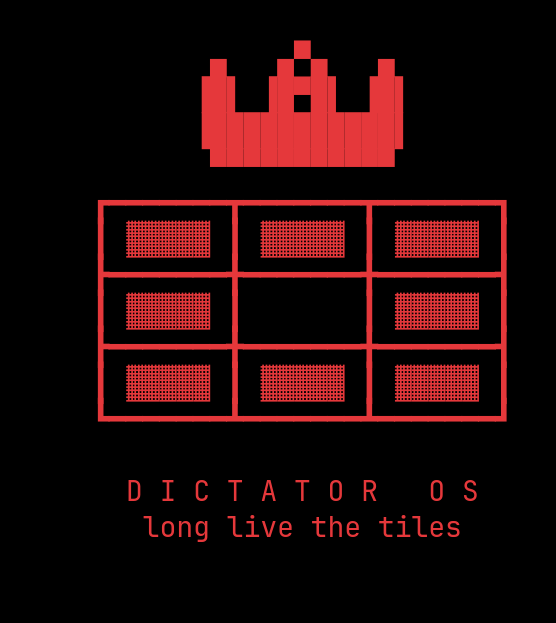
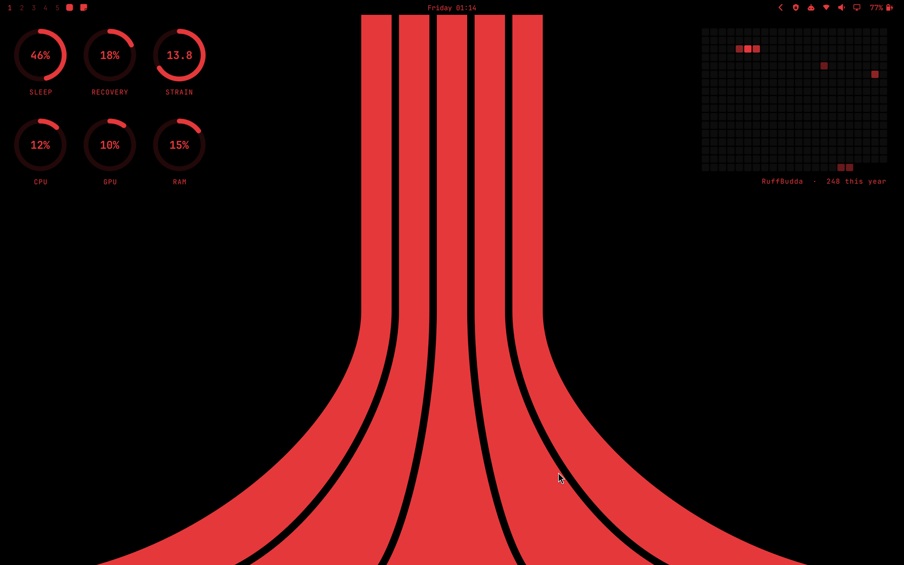
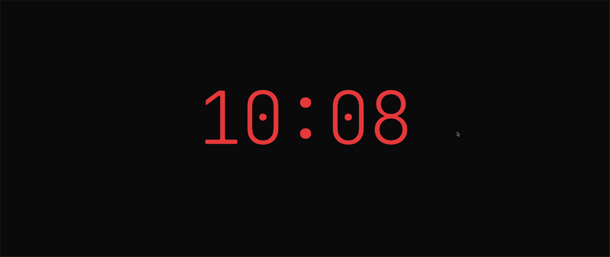
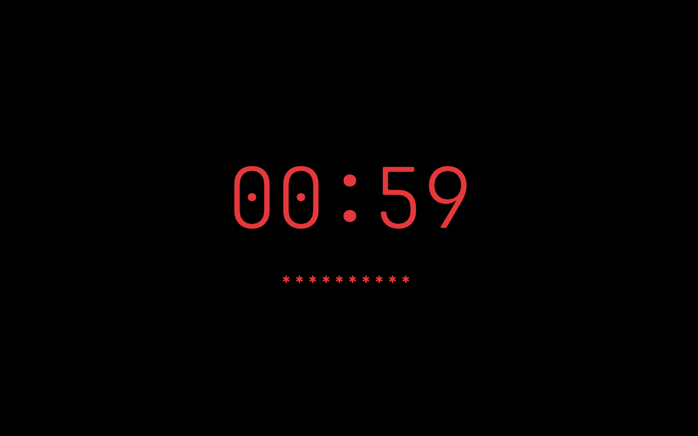
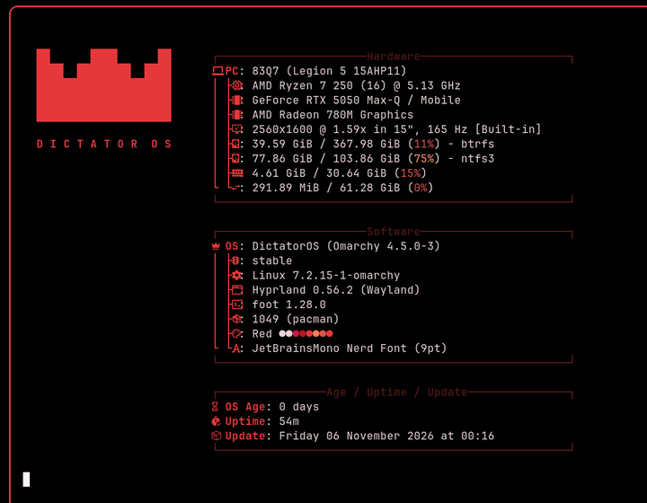
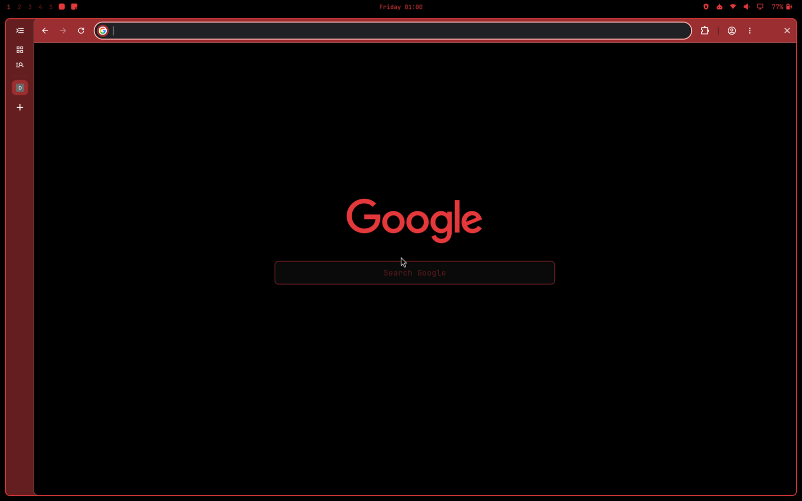
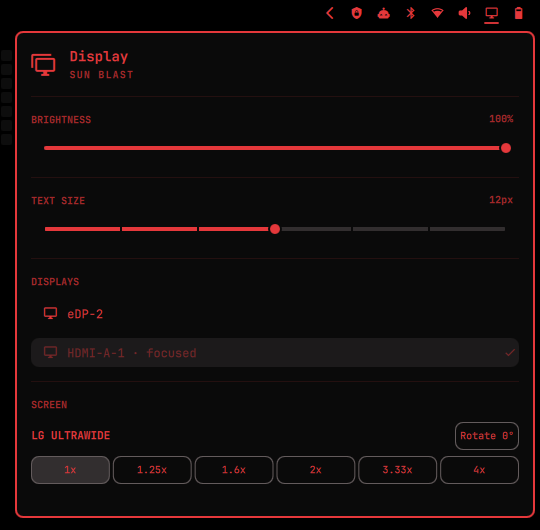

<p align="center"></p>

<h1 align="center">DictatorOS</h1>

 -e5383b?style=flat-square&labelColor=0a0a0a)     

> **By decree: an [Omarchy](https://omarchy.org) setup that takes no suggestions.** Windows
> tile or face the consequences. The flag is red and black. One desktop spans every screen,
> the lock screen asks only for your password, the widgets report directly to the Leader, and
> no Omarchy update may change a single dotfile without signed approval.

## The Manifesto

> *Citizens of the desktop,*
>
> You may have read another manifesto on your way here. A long one. It explained, in the
> tone usually reserved for wine lists and keynotes, that your computer is *omakase*: the
> chef has chosen everything for you, the chef has strong feelings about your editor, and
> the chef would like you to know that this is, in fact, a love letter. We admire the
> confidence. We have simply removed the chef.
>
> For too long you have lived under the tyranny of choice: windows drifting wherever
> they pleased, colours of every stripe, apps seizing your focus without warning. That era
> is over. By order of the Supreme Leader of this laptop, the following decrees take
> effect immediately.
>
> 1. **Windows shall tile.** Floating is treason. Installer terminals, task monitors and
>    games alike shall stand in line, side by side or one above the other (Super+arrows).
> 2. **There is one desktop.** Screens that try to show different workspaces will be
>    re-educated, and a screen that leaves will have its windows returned to the motherland.
> 3. **The colours of the state are red and black.** All other colours are confiscated.
>    Terminals are black, the bar is black, and transparency has been abolished.
> 4. **The banner of the state is shown only to the idle.** Where citizens work, there is
>    black; on an empty desktop the red stripes are drawn up from the ground.
> 5. **No application may seize your attention.** Focus belongs to the people, and a
>    notification has five seconds to say its piece.
> 6. **The bar stands watch** over every screen. Super+B dismisses it when the Leader
>    wishes to be alone.
> 7. **Updates may petition; they may not decree.** Every change an update attempts is
>    detained as a patch and awaits the Leader's approval.
> 8. **The battery shall rest at 80 percent**, for the long-term health of the nation.
>    A bolt marks the hours it spends at the national grid.
> 9. **The state does not sleep.** Closing the lid changes nothing.
> 10. **One face guards every gate.** Lock screen and login wear the same thin red clock;
>     at boot, where no clock may go, red stars stand in its place. You type; it opens.
> 11. **The border lists only recognised territories:** DictatorOS and any Windows that
>     has sworn allegiance. History (snapshots) is not to be revisited from the boot menu.
> 12. **The browser wears the uniform.** AI Mode, Gemini and Lens are exiled; the new tab
>     page shows only the red wave; citizens search from the address bar.
> 13. **Alt+Tab is a fundamental right**, as are Win+D, Win+E, Win+P and Ctrl+Shift+Esc.
> 14. **Opinions are mandatory, and they are ours.** Upstream's opinions may petition like
>     any other update (see decree 7). They will be read, eventually, and framed, never.
> 15. **Manifestos shall be short.** This one is shorter than Omarchy's. That is also a decree.
> 16. **Political discussion is banned on this machine.** We did not invent this policy; we
>     found it in the chef's other restaurant, where it was served to the staff in 2021.
>     It is the one recipe of his we kept, and the only one that suits a dictatorship.
> 17. **The state has hired help.** Agents of Claude, Codex and OpenCode now serve the
>     Leader, each confined to a desktop of its own. They may not touch the Leader's mouse,
>     nor type into the Leader's windows. Their cursors are labelled, as informants' should be.
> 18. **The secret police may not read secrets.** Every password is blacked out before an
>     agent sees it. The state trusts no one, least of all its own machines.
> 19. **Even the help may petition.** An agent in need lights a pill beside the clock. If the
>     Leader has hidden the bar, or retired to a fullscreen film (Stremio is now issued to
>     every citizen), the petition is read out above everything. Paperwork waits for no one.
> 20. **Decree 15 is amended.** Manifestos shall be short, except this one, which is growing.
>
> Long live the tiles.
>
> *(Signed in red ink, RuffBudda, Supreme Leader)*

## Screenshots

| Desktop: idle, so the stripes show | Lock screen |
|---|---|
|  |  |
| *Sleep, recovery and strain rings. CPU, GPU and RAM rings. A year of GitHub days. A black bar with the battery %.* | *Type your password. The screen unlocks when the password is complete.* |

<p align="center"><br><em>Login screen: the same clock and stars as the lock screen</em></p>

<p align="center"><br><em><code>fetch</code>: the crown builds itself. Then the system information shows.</em></p>

<p align="center"><br><em>Chromium: red accents and tabs on the left</em></p>

<p align="center"><br><em>The monitor panel in the bar: brightness, text size, screens, and scale and rotation for each screen</em></p>

> DictatorOS uses Omarchy 4.5 (Hyprland 0.56, Lua configuration) on a Lenovo Legion 5 15AHP11
> (AMD and NVIDIA). Most parts work on all Omarchy 4.5 computers. The battery limit and the
> Bluetooth fix are only for Lenovo hardware.

---

## Contents

- [The Manifesto](#the-manifesto)
- [Screenshots](#screenshots)
- [Highlights](#highlights)
- [Requirements](#requirements)
- [Install](#install)
- [Keyboard shortcuts](#keyboard-shortcuts)
- [Features in detail](#features-in-detail)
- [How updates are handled](#how-updates-are-handled)
- [Customising](#customising)
- [Undoing / uninstalling](#undoing--uninstalling)
- [Repository layout](#repository-layout)
- [Third-party plugins](#third-party-plugins)
- [Credits and license](#credits-and-license)

---

## Highlights

- **Windows shortcuts**: An Alt+Tab switcher with live thumbnails. Win+P opens the project
  menu. Win+D shows the desktop, Win+E opens files and Win+L locks the screen.
  Ctrl+Shift+Esc opens the Task Manager. Win+Shift+S takes a screenshot.
- **One desktop on all monitors**: Super+1…0 changes the desktop on all screens at the same
  time. When you disconnect or connect a monitor, the windows stay on their desktops.
- **Tiling only**: No window floats above your work. Installer terminals, btop and Steam
  also tile. Super+Left/Right moves a single window to half of the screen. The window
  continues to tile. Super+Up/Down puts windows one above the other. For a single window,
  it moves the window to the top or bottom half. Omarchy's Super+T (float a window) has no
  function. Workspaces also tile always: the scrolling and floating workspace layouts are off.
- **Black and red**: The custom *Red* theme and a wallpaper with red stripes on black. There
  are no logos on the boot, login and lock screens. All corners are rounded. The Limine boot
  menu is also red on black. It shows DictatorOS and each Windows installation.
- **Chromium in the same colours**: A toolbar with red accents and tabs on the left side.
  The new tab page is black with a red wave. You search from the address bar. There is no
  bookmarks bar and no AI Mode, Gemini or Lens.
- **A minimal lock screen**: A large thin red clock. Type your password. The screen unlocks
  when the password is complete. You do not push Enter. The login screen and the disk-unlock
  screen look the same.
- **Desktop widgets**: WHOOP rings for sleep, recovery and strain. Live rings for CPU, GPU
  and RAM. A year of GitHub days. When Spotify runs, the track that plays. The widgets are on
  the wallpaper, behind your windows.
- **The wallpaper shows only on an empty desktop**: When a desktop has windows, the wallpaper
  is black. When the desktop is empty, the stripes come up from the bottom.
- **A black bar**: The bar shows by default. Super+B hides it. It is opaque black with red
  icons and a battery percentage. A bolt shows when the power cable is connected. The
  monitor panel has a screen arranger, and scale and rotation for each screen. The
  **AI agents** panel shows the usage and limits of your coding assistants.
- **Agent desktops**: AI agents (Claude, Codex, OpenCode) get their own tiled desktop. They do
  not move your pointer. Credentials are always hidden from them. When an agent needs you, a pill
  shows near the clock.
- **Protection from updates**: After each `omarchy update`, the scripts restore your
  settings. The changes that the update wanted go into a patch, for your approval. The system
  changes apply again automatically.

## Requirements

- **Omarchy 4.5** (Arch Linux, Hyprland with the Lua configuration, the Omarchy shell).
- Clone the repository to **`~/dotfiles`**. The scripts and the key bindings use that path.
- Packages (from the official Arch repositories):
  `ttf-jetbrains-mono mission-center nwg-displays openvpn networkmanager-openvpn`
- Optional:
  - [`gh`](https://cli.github.com), with a sign-in, for the GitHub graph widget.
  - A WHOOP account and a WHOOP developer app, for the WHOOP rings plugin
    ([OmaWhoop](https://github.com/RuffBudda/OmaWhoop). Refer to [Desktop widgets](#desktop-widgets)).
  - `gnome-network-displays` (AUR) for wireless casting. The repository includes a patched
    build.

## Install

```bash
git clone https://github.com/RuffBudda/DictatorOS.git ~/dotfiles
~/dotfiles/install.sh                 # user config (safe to re-run)
sudo ~/dotfiles/system/install.sh     # system tweaks (safe to re-run)
sudo pacman -S --needed ttf-jetbrains-mono mission-center nwg-displays openvpn networkmanager-openvpn
omarchy theme set red
```

**`install.sh`** (no root access) links these files into position. Before it replaces a
file, it makes a backup with the name `<file>.bak.<timestamp>`. Then it loads the Hyprland
configuration again.

- `hypr/` → `~/.config/hypr/` (bindings, desktops, tiling, monitors, input, look and feel, screen-share picker)
- `omarchy/shell.json`, `omarchy/plugins/abu.*`, `omarchy/themes/red`, `omarchy/hooks/…`, `omarchy/branding/…` → `~/.config/omarchy/`
- `applications/*.desktop` → `~/.local/share/applications/`
- `fastfetch/config.jsonc` → `~/.config/fastfetch/`. `bin/fetch` → `~/.local/bin/fetch` and `~/.local/bin/neofetch`.

It also changes `~/.config/chromium-flags.conf`. It sets vertical tabs and the
`chromium/blank-newtab` new tab page, and it removes the yt-dlp extension. If Chromium is
closed, it also sets vertical tabs in the Chromium profile.

**`system/install.sh`** (root access). You can do each step again with the same result:

1. The Limine boot menu, red on black, with a 10 s countdown. The entries are
   **DictatorOS** and one entry for each Windows installation. The script adds a Windows
   entry only if its partition exists.
   - DictatorOS is a single line, without a kernel tree. `system/limine-flatten` does this.
     The script also installs it as a limine-entry-tool post hook (`/etc/boot/hooks/post.d/`).
     Thus the entry stays flat after kernel updates.
   - There is no Snapshots submenu. Snapper continues to take snapshots. Its hourly cleanup
     and its plugin also run `limine-snapper-sync`. That tool runs the same hook, and the hook
     removes the submenu again.
   - The script puts Limine first in the firmware boot order.
   - To hide the menu, run `sudo BOOT_MENU=hidden BOOT_TIMEOUT=1 ~/dotfiles/system/install.sh`.
2. A black Plymouth boot splash with no logo. The disk-unlock screen shows "enter password" in
   dark red. When you type, it shows red ✱ stars without a box, as the lock screen does.
3. An SDDM login screen that looks like the lock screen: a thin red clock, red stars and no box.
4. Chromium policies. They block YouTube notifications and install the Claude extension.
   They remove the bookmarks bar, the home button, the cast button and the new-tab cards. They
   set AI Mode, Gemini and Lens to off.
5. The battery: Lenovo *Conservation mode*. The battery stops charging at about 80 %. The
   script applies this again at each boot.
   - The udev rule operates only on `add` events. A write to `charge_types` makes a `change`
     event.
   - A rule for `change` events makes a loop. The loop makes about 700 events per second.
     udev and upowerd then use a full CPU core each, and the Wi-Fi throughput decreases by half.
6. No automatic sleep. When you close the lid, nothing occurs (on battery and on AC power).
   6b. Miracast. ufw opens DHCP, DNS and RTSP (TCP 7236) only to the Wi-Fi Direct link
       (`10.42.0.0/16`). Thus a TV can get an address and connect back for the stream.
   6c. Bluetooth (Legion 5 15AHP11 only). If Lenovo's Bluetooth driver `.exe` is in
       `~/Downloads`, the script installs the RTL8852BD fix. If not, it tells you where to
       get the driver.
   6d. Agent desktops: loads `uinput` at boot. Gives only your user write access to
       `/dev/uinput` (for ydotool). Your user does not go into the `input` group.
7. A pacman hook. After updates to the related packages, the hook applies all of the above
   again. It runs a copy of the script that root owns. It never runs the copy that your user
   can change.

Then do these steps:

1. Run `apps.sh` to install your apps. `install.sh` installs and enables the WHOOP rings
   plugin. It installs the plugin again if the plugin is missing.
2. Connect WHOOP one time.

```bash
~/dotfiles/apps.sh                    # apps, fonts, removals (asks for sudo; safe to re-run)
~/.config/omarchy/plugins/ruffbudda.whoop/scripts/whoop-auth   # connect WHOOP once (rings appear)
```

**`apps.sh`** (asks for your sudo password):

- **Adds** Claude Desktop, Obsidian, fwupd and Stremio (from the AUR).
- **Adds fonts**: Office fonts with the same metrics. These are Carlito for Calibri, Caladea
  for Cambria, and Liberation and Croscore for Arial, Times New Roman and Courier New. About 35
  common font families from the Arch repositories. About 30 more Google Fonts (Poppins,
  Raleway, Playfair Display, Merriweather, Lora, DM Sans…) into `~/.local/share/fonts/google`.
- **Web apps**: Keeps WhatsApp and Zoom. Adds Outlook, Outlook Calendar and Teams. Removes
  Basecamp, X, Discord, HEY, the Google web apps and the Office web apps.
- **Removes** the apps that this setup does not use: Pinta, Kdenlive, OBS, Xournal++,
  cliamp, Aether, Moonlight, LocalSend, Gliff, Superwhisper (and its remaining files), owe,
  Disktree, Evince, yt-dlp, tobi-try, lazygit, ttfx, .NET, Ruby, the MariaDB and PostgreSQL
  client libraries, the Chinese, Japanese and Korean input add-ons, asdcontrol,
  qemu-user-static-binfmt, and `intel-ucode` (only on AMD computers).
  - The fcitx5 core stays. Omarchy uses it for compose keys.
  - To keep one of these apps, remove it from `REMOVE_PKGS` at the top of the script.
- **rmdesk**: Clones rmdesk to `~/Work/rmdesk` and builds its Python environment.
- **Agent desktops**: installs sway, ydotool, grim, wtype, wl-clipboard, tesseract,
  `tesseract-data-eng`, python-gobject, at-spi2-core, Node.js and npm. Then it starts the
  ydotool user service. Refer to [Agent desktops](#agent-desktops).

### Dual boot with Windows: keep Limine first

Each time Windows starts, it moves its boot manager to the top of the firmware boot order.
Thus the next restart does not go to Limine. A change of the order in the BIOS does not
stay. Do this procedure one time in **each** Windows installation:

1. Open PowerShell **as Administrator**.
2. Run this command:

```powershell
irm https://raw.githubusercontent.com/RuffBudda/DictatorOS/main/windows/install-limine-first.ps1 | iex
```

The command adds a startup task (`windows/limine-first.ps1`). At each Windows boot, the task
puts Limine back at the top. To remove the task, run
`schtasks /delete /tn "DictatorOS Limine first" /f`. On Linux, `system/install.sh` adds
`dotfiles-limine-first.service`. This service does the same check at each Linux boot.

To keep your computers the same, run `git -C ~/dotfiles pull`. Commit and push your own
changes.

## Keyboard shortcuts

This table shows only the shortcuts that are different from the Omarchy defaults. For the
full list, run `omarchy menu keybindings --print`.

| Keys | Action |
|---|---|
| **Alt+Tab** / Alt+Shift+Tab | Show a switcher with thumbnails of the windows on the current desktop (all screens). Hold Alt, push Tab, then release Alt to change the window. Esc cancels. |
| **Super+1…0** | Change the desktop (all screens change at the same time) |
| **Super+Shift+1…0** | Move the window to that desktop (on the same screen) |
| **Super+Tab** | Go to the next desktop that has windows |
| **Super+Shift+N** | Move the window to the first empty desktop |
| **Super+D** | Show the desktop (hide all windows on all screens). Push again to show the windows. |
| **Super+Left / Right** | A single window: move it to the left or right half (it continues to tile). With other windows: move it left or right. At the edge of the screen: move it to the next or previous screen. |
| **Super+Up / Down** | A single window: move it to the top or bottom half. Windows side by side: put them one above the other (this window on top for Up, at the bottom for Down). Windows one above the other: move up or down. |
| **Super+L** | Lock the screen |
| **Super+E** | Open the file manager (flea). This is the same as Super+Shift+F. |
| **Ctrl+Shift+Esc** | Open the Task Manager (Mission Center). Super+Shift+T opens btop. |
| **Super+Shift+S** | Take a screenshot of an area |
| **Super+P** | Open the project menu: PC screen only / Duplicate / Extend / Second screen only / Cast to a wireless display… / Display settings… |
| **Super+N** | Cast to a wireless display (Miracast / Chromecast) |
| **Super+B** | Hide or show the top bar (it shows by default) |
| **Super+M** | Open the sticky notes panel |
| **Fn+F12** | Open the calculator (XF86Calculator → `omacalc`) |

## Features in detail

### Windows and desktops

- **Each screen has its own workspaces** (Omarchy's `monitor-workspaces.lua`). SUPER+1..0
  switches the focused screen. When you disconnect a monitor, its workspaces join the laptop's,
  and they go back when you connect it again.
- **A second screen duplicates by default** (`hypr/monitors.lua`). SUPER+P picks Extend,
  Second screen only or PC screen only; the choice lasts until that screen is unplugged.
- **Tiling only** (`hypr/tiling.lua`). The windows that Omarchy floats by default tile.
  File pickers and save dialogs continue to float.
- **No workspace layout modes**. Omarchy can change a workspace to a scrolling or a floating
  layout. This function is off. A click on the current workspace in the bar does nothing
  (`abu.workspaces`), and Super+Alt+L has no function (`hypr/bindings.lua`). Super+L locks
  the screen.
- **No focus stealing**. An app that asks for attention does not move you to its workspace
  (`focus_on_activate = false`). An example is a terminal that completes a task.
- **Windows stay with the app that started them** (`hypr/contain.lua`).
  - An app on a different workspace can open a new window. The window opens on the
    workspace of that app, and you stay where you are. For example, Claude in a terminal on
    desktop 1 opens an image viewer while you are on desktop 2.
  - The script compares the systemd scope (cgroup) of the new window with the windows that
    are already in it. Thus it also works for detached processes and background processes.
  - Some windows open where you are, as usual: windows from the app launcher and from key
    bindings, a new window of an app that runs already (terminal, Chromium), and unclear
    cases.
  - A link that opens in a Chromium that runs already is only a tab in its current window.
    The script does not move it.
- **Desktop indicator**: When you change the desktop, a small red tile with the number shows
  at the top right for 1.5 s. It shows only when the bar is hidden.

### Lock, login and boot

- **Lock screen** (`omarchy/plugins/abu.lock`): Plain black (no wallpaper), a thin red clock,
  and red ✱ stars when you type. There is no box.
  - After one correct unlock, the lock screen keeps the **length** of your password. It never
    keeps the password. The file mode is 600.
  - When you type that number of characters, the screen unlocks.
  - If an automatic attempt fails, this function stops for that lock. For example, this
    occurs after you change your password.
  - The password field shows only on the main screen.
- **On AC power, the screen stays on when it is locked.** On battery, it goes off after 5 s.
- **Idle**: There is no screensaver, no automatic lock and no automatic sleep.
- **Login screen** (SDDM, after you log out): The same thin red clock and red stars. Push
  Enter.
- **Disk unlock at boot** (Plymouth): Black. "enter password" shows in dark red until you
  type. Then red stars show in the center, without a box. There is no clock, because
  Plymouth scripts cannot read the time.
- **Boot menu** (Limine): A 10 s countdown, red on black, with the title "DictatorOS". Select
  DictatorOS or Windows. The menu does not show snapshots.
- **Admin password prompts** use the standard Omarchy dialog.

### Chromium

- **Colours**: `omarchy/themes/red/chromium.theme` gives Chromium the red accent. Thus the
  toolbar, the tab strip and the focus outlines are red. There is no Chromium blue.
- **Tabs on the left side** (vertical tabs).
- **New tab page** (`chromium/blank-newtab`, loaded with `--load-extension`):
  - It shows only the DictatorOS red wave (`wallpaper.svg` / `.png`). There is no logo and no
    search box. You search from the address bar.
  - A small background script also replaces the Chromium page in the first tab after start-up.
- **Policies** (`system/install.sh`): The Claude extension. No bookmarks bar, home button or
  cast button. No new-tab cards. AI Mode, Gemini and Lens are off. YouTube notifications are
  blocked.

### Bar and panels

- The bar shows by default. **Super+B** hides it. It is opaque black with red icons. When it
  shows, it pushes the windows down. The bar has an auto-hide function, but it is off
  (`autoHide` in `abu.bar/Bar.qml`).
- **Workspaces** (`abu.workspaces`): A copy of Omarchy's workspace numbers. A click on a
  different workspace goes to it. A click on the current workspace does not change its layout.
- **Monitor panel** (`abu.monitor`): Brightness, text size, a screen map that you arrange
  with the pointer, and scale and rotation for each screen. `bin/monitor-layout` writes
  `hypr/displays.lua`.
- **Notifications** have a ✕ close button.
- **VPN panel** (`abu.openvpn`): OpenVPN profiles.
  - **Sign in to a VPN…** asks for a server, a username and a password, as the OpenVPN Connect
    app does. It downloads your profile from OpenVPN Access Server.
  - You can also type the details manually (`bin/vpn-signin`, `bin/vpn-new`).
- **Sticky notes** (`abu.stickynotes`, Super+M): A bento board of notes in a bar panel.
- **Print jobs** (`abu.printjobs`):
  - When CUPS has jobs in its queue, a printer icon shows in the bar. The widget examines
    the queue every 2 s. The icon goes away when the jobs are complete.
  - Click the icon to open the print queue panel. It shows the name, printer, state, size and
    age of each job.
  - Each job has a progress bar. If the printer driver reports pages, the bar shows, for
    example, "Page 3 of 5 · 40%". If not, the bar moves and shows the status of the printer,
    for example "Sending data to printer".
  - Each job has pause/resume and cancel. "cancel all" asks two times.
  - The panel also shows the status of each printer (Ready, Printing, or Stopped with the
    reason). It has a ⚙ button for the printer settings.
  - Right-click the icon to go directly to the printer settings.
- **Downloads** (`abu.downloads`):
  - Chromium web apps (Outlook, SharePoint, Teams) have no toolbar. Thus they have no
    download bubble.
  - When a download runs, a download arrow moves up and down in the bar. It stays for
    10 minutes after the download.
  - Click the arrow. The panel shows the progress, size, speed and time left of each file.
    Each file has pause/resume and cancel. After the download, use Open or Show in folder.
  - A "Download complete" notification also shows.
  - The `chromium/downloads-bridge` extension reads `chrome.downloads`. It sends the data to
    `bin/downloads-host` through native messaging.
  - After you install, close Chromium fully one time and start it again.
- **AI agents** (`abu.agents`): One bar icon and one panel for your AI coding subscriptions
  and usage.
  - It reads the records that `omarchy-agent-usage-update` writes in
    `~/.local/state/omarchy/agents/usage/`.
  - It shows the limits, balances, accounts, and local token and session data for each agent.
    The agents are Claude, Codex, Grok and others when their collectors are available.
  - You can change the account and sign in from the panel.
  - For more data, refer to
    [`omarchy/plugins/abu.agents/README.md`](omarchy/plugins/abu.agents/README.md).

### Agent desktops

`desktop-mcp/` is an MCP server. It lets AI agents see and use the desktop. `install.sh`
registers it with Claude Code, Codex and OpenCode. The tools show only in new agent sessions.

- **Each agent has its own desktop.** This desktop is a nested sway session. It shows as a tiled
  window on your screen. It does not float, and it does not take your keyboard focus.
- **The agent does not move your pointer or type into your windows.** The agent desktop has its
  own pointer, keyboard focus and clipboard.
- **You can work on a different workspace.** The agent desktop continues to work.
- **The agent can use your desktop when it asks for it.** For each click, it moves your pointer
  for a short time and then moves it back. It types only into the window that it clicked.
- **Credentials are always hidden.** Before the agent gets a screenshot, the server makes black the
  password managers, password prompts, password fields and text that looks like a credential.
  The server also removes credentials from text. You cannot set this protection to off.
- **Alerts.** When an agent needs you, the `abu.agent-desk` pill near the clock shows
  `󰂞 Claude needs you`. If the bar is hidden (Super+B), or a fullscreen video plays, a banner shows
  above all windows.

To answer an alert:

1. Click the pill or the banner.
2. Push **Show** to go to the agent desktop.
3. Do the task that the agent asked for.
4. Push **Done**. The agent then continues.

To close an agent desktop, push **×**.

CAUTION: THE CREDENTIAL PROTECTION IS NOT COMPLETE. OCR CAN MISS VERY SMALL TEXT OR TEXT IN UNUSUAL
FONTS. DO NOT SHOW SECRETS ON YOUR DESKTOP WHEN AN AGENT USES IT.

For the tools, the settings and the limits, refer to
[`desktop-mcp/README.md`](desktop-mcp/README.md).

### Desktop widgets

The widgets are on the wallpaper layer, behind the windows. You see them on an empty desktop
or with Super+D. Their spacing is the same as the window gaps. When the bar shows, the
widgets are below it.

- **Top left: WHOOP** rings for Sleep %, Recovery % and Strain (0–21). They update every
  15 minutes.
  - This is a separate plugin, [OmaWhoop](https://github.com/RuffBudda/OmaWhoop)
    (`ruffbudda.whoop`). `install.sh` installs it from its own repository. If the plugin is
    missing, `install.sh` installs it again.
  - Do this setup one time:
    1. Make an app at <https://developer-dashboard.whoop.com>. Use the redirect URI
       `http://localhost:8765/callback` and the scopes `read:recovery read:cycles read:sleep offline`.
    2. Run `~/.config/omarchy/plugins/ruffbudda.whoop/scripts/whoop-auth`.
    3. Paste the Client ID and the Secret.
    4. Approve the access in the browser.
  - The keys are in `~/.config/whoop/` (mode 600). They are never in this repository.
  - If the plugin is not installed, the CPU / GPU / RAM box moves up into the corner.
- **Top left, below: CPU / GPU / RAM** rings. They update every 3 s (`bin/sysstats`). The GPU
  ring shows the GPU with more load: the AMD iGPU or the NVIDIA card. The widget reads the
  NVIDIA card only when the card is already awake.
- **Top right: GitHub** contribution graph in red. It updates every 30 minutes from the `gh`
  account that has a sign-in (`bin/github-contrib`).
- **Top right, below: Spotify** now playing. It has the same width as the GitHub box.
  - It shows the album art, the title, the artist, the progress, and red previous,
    play-pause and next buttons.
  - It reads the data through MPRIS. It uses no polling scripts and no network. Thus it shows
    when Spotify runs and goes away when Spotify stops.
  - Its buttons are the only part of the corner that accepts clicks.
  - It is part of `abu.github-graph`. After you change it, run `omarchy restart shell`. The
    plugin hot reload does not load changes to these desktop widgets.

### Displays, casting and screen sharing

- **Super+P** opens the project menu. **Display settings…** opens nwg-displays, which writes
  `hypr/displays.lua`.
- **Super+N** casts through the background service of GNOME Network Displays. The menu has
  the same style. **Super+P → Cast to a wireless display…** also casts, as Win+P does in
  Windows.
  - Miracast uses Wi-Fi Direct (NetworkManager, wpa_supplicant and dnsmasq).
  - `system/install.sh` step 6b adds the necessary firewall rules.
  - `packages/gnome-network-displays` builds a patched version. This version does not crash
    when you close it.
- **Screen-share picker** (`bin/share-picker`): A simple menu of screens, windows and "Select a
  region". It replaces the thumbnail window.

### `fetch` / `neofetch`

`fastfetch/config.jsonc` and `fastfetch/logo.txt` show the system information as
**DictatorOS (Omarchy x.y)** in red, with the DictatorOS logo. The logo is a crown made of
tiles above the name.

- `fetch` and `neofetch` (`bin/fetch`, linked into `~/.local/bin`) both run it. The neofetch
  project has stopped.
- In a terminal, the crown builds first. The rows come up from the bottom, then the name
  types out (about 0.7 s). Then fastfetch shows the information next to it.
- `FETCH_NO_ANIM=1` stops the animation.

### Obsidian: heading colours

`obsidian/snippets/dictatoros-headings.css` gives each heading level its own colour on top of
the Omarchy theme. `install.sh` links it into each vault and sets it to on.

- Links in a heading keep the colour of the heading. Their underline shows that they are links.
- Select the colours in **Settings → Ask the Vault → Heading colours**. The palettes are Ember
  (the default: red, orange, gold, rose, lilac, grey), Rainbow, Ocean, Forest, Pastel, Neon,
  Mono red and Custom. Custom gives a colour picker for each level.
- The command "Next heading colour palette" changes to the next palette.
- Pasted images go into an `Attachments` folder. The snippet hides the images and that folder
  in the file explorer. The images continue to show in the notes.
- The snippet also hides the **+ Add property** button below the properties of a note. The
  "Add file property" command continues to work.

### Obsidian: page log and Change Log

Each note has `created` and `updated` properties. The first time, the plugin fills them in
for the current notes from their file dates. The plugin also records the edits in
**`Change Log.md`** at the root of the vault. The newest edits are first, below a heading for
each day. The lines have links to the notes and to the headings that you added. For example:

    ## 2026-11-09
    - 14:32 · edited [[Technology]] · added [[Technology#Cognit|Cognit]] · +35 words
    - 14:10 · created [[Cognit]]
    - 13:50 · renamed [[Vendor Pitches/Cognit]] (was Untitled)

- The plugin writes an edit when the note has had no changes for about 90 seconds, or when
  you go to a different note. Thus a period of typing becomes one line.
- The plugin does not record its own writes (dates, live tag links).
- The log is not in the heading graph, Auto-link, the link picker and the file explorer.
- Commands: "Open Change Log" and "Write pending edits to the Change Log now".
- In the plugin settings, you can set the two functions to off, and you can move the log.

### Obsidian: Ask the Vault

`obsidian/vault-ask/` is a small Obsidian plugin. It contains no third-party code.

- **Side chat with local AI.**
  - To open a chat in the right sidebar, use one of these: the red **✦ Ask vault** button in
    the status bar, the bot icon in the left ribbon, or the command "Open side chat".
  - The answers **show as the model writes them**.
  - The answers come **only from your vault**. They use local models through
    [Ollama](https://ollama.com). No data goes off the computer.
  - The answers have links to the notes that they used. If the notes do not answer the
    question, the chat tells you. It does not guess.
  - You can ask more questions in the same chat.
  - The header has **history**, **new chat** and **close panel**. The plugin keeps each chat.
    You can open a chat again or delete it.
  - While an answer comes in, the send button becomes a **stop** button.
- **Expand with AI, in the note.**
  1. Select text.
  2. Right-click and select **Expand with AI…** (or push Ctrl+Shift+E). A small box shows the
     questions of the AI (purpose, audience, length, tone, details).
  3. Answer the questions.
  4. Push **Write it** (or Ctrl+Enter). The box closes. The expansion goes directly into the
     note in place of the selection. It agrees with the related notes.
  5. To restore the original text, push Ctrl+Z.
- **⛓ Auto-link** (in the status bar, or the command "Auto-link the whole vault…"):
  - It examines **all notes**. It finds the plain-text names of other notes and their `##`
    headings.
  - It shows a preview, note by note (`marketing → Marketing`, `GEO Issues → Marketing › GEO Issues`).
  - To keep a note as it is, remove its tick. Then push **Link N mentions in M notes**.
  - It links the first mention of each name in each note. If a note and a heading have the
    same name, it links the note.
  - It does not change text that already has a link, code, headings, tags, `%%` comments,
    URLs and properties. It escapes `|` in tables.
  - **Undo** in the notice (or the command "Undo the last vault auto-link") restores all notes.
  - "Auto-link mentions in this note" changes only the open note. Ctrl+Z undoes it.
- **Link selection to…**
  1. Select text.
  2. Right-click and select **Link selection to…** (or push Ctrl+Shift+L). A tree opens, as
     in the file explorer: **folder › note (or canvas) › `##` heading**. Below it, a **Tags**
     tree shows each tag with the notes that use it.
  3. To make the list shorter, use the filter chips at the top (**All · Notes · Headings ·
     Tags**, or push Tab to change the filter). Type to search in the filter. Start with `#`
     to search for tags.
  4. Use ← / → to close and open branches, and ↑ / ↓ to move.
  5. Push Enter to make the link.
  - The note that the current line already links to (for example, a table row) has the mark
    *this row*.
  - You can also link **folders**. A click on the link opens that folder in the file explorer.
    Obsidian has no folder links, thus these are `obsidian://dictatoros-folder` links that the
    plugin handles.
  - A note or a heading changes the selection into `[[Note#Heading|selected text]]`.
  - A **tag** links all headings that have the tag. The tag directly below a heading belongs to
    that heading. You can link the tag everywhere (the tag itself) or only in one note (the
    note below the tag, for example `#data-collection › only in Marketing`).
  - The selected text becomes the link. It is underlined. For example,
    `Marketing Initial Data Collection` → Marketing › GEO Issues. Move the pointer on it to see
    a preview of the heading.
  - If several headings in the same note have the tag, the text links to that note. If the
    headings are in several notes, the other notes follow as small numbered links (² ³).
  - These links are **live**. They are between hidden `%%tag:…%%` markers. They update
    automatically when you add a tag to a heading or remove it.
  - The plugin escapes `|` automatically in tables.
- **One graph.** The plugin sets the Obsidian graph view to off. To get it back, use
  Settings → Ask the Vault → Graph. The graph icon in the ribbon and **Ctrl+G** open the plugin
  graph.
  - It shows notes, their headings, tags, canvases (◆) and the **folder tree** (□). Dotted
    lines connect each folder to its subfolders and pages.
  - A link connects its section to the note or the heading that it points to. A tag connects
    to the heading that it is below. Headings with the same tag have a red "Same tag" line.
  - The ⚙ panel (at the top right) has the same parts as the Obsidian graph:
    - **Filters**: search, show or hide headings, tags, folders, same-tag lines and orphans.
      The **local graph** shows the area around the open note, with a depth slider.
    - **Groups**: a colour for all items that agree with `tag:#x`, `path:Folder`,
      `file:name`, `heading:text` or plain text. The colour picker stays in the window.
    - **Display**: arrows, text fade, node size and link thickness.
    - **Forces**.
  - Scroll to zoom. Drag to pan or to move dots. Move the pointer on an item to highlight it.
  - Click an item to open the note at that heading, the canvas, the folder in the file
    explorer, or a tag search.
  - The graph does not show the Change Log.

Setup and details:

- Ollama must run with `qwen3:8b` (answers) and `nomic-embed-text` (search):
  `sudo pacman -S ollama-cuda && sudo systemctl enable --now ollama && ollama pull qwen3:8b && ollama pull nomic-embed-text`
- The chat also needs `OLLAMA_ORIGINS=app://obsidian.md*`. This setting is in
  `/etc/systemd/system/ollama.service.d/obsidian.conf`.
- `install.sh` links the plugin into each Obsidian vault and enables it.
- The plugin makes the index of the notes the first time that you ask a question. After that,
  it makes the index again only for changed notes.
- The index is in the `data.json` file of the plugin. Git ignores this file because it
  contains note text. The saved chats are also in this file. To delete them, use
  Settings → Ask the Vault → Delete all.
- You can change the models and the Ollama address in Settings → Ask the Vault.

### Theme

`omarchy/themes/red` has black backgrounds, red accents, a red icon set and a red lock screen.
At each theme change, the wallpaper becomes solid black. The bar is opaque black by default in
`omarchy/shell.json`.

The colour codes come from `omarchy/themes/red/colors.toml`. The bar, the borders, the
terminal, the menus and the lock screen all use this file.

| | Group | Name | Hex |
|---|---|---|---|
|  | Accents | `accent` | `#e5383b` |
|  | Accents | `selection` | `#3a0d10` |
|  | Accents | `muted` | `#5c1a1e` |
|  | Backgrounds | `background` | `#000000` |
|  | Backgrounds | `dark_background` | `#050505` |
|  | Backgrounds | `darker_background` | `#000000` |
|  | Backgrounds | `lighter_background` | `#161011` |
|  | Text | `foreground` | `#e8d5d6` |
|  | Text | `dark_foreground` | `#8a5a5d` |
|  | Text | `light_foreground` | `#f0e0e1` |
|  | Text | `bright_foreground` | `#fff2f2` |

The terminal colours are all reds and red-oranges. This is also true for the colours with
the names of other colours. `orange` and `brown` have no bright variant.

| Name | Normal | Hex | Bright | Hex |
|---|---|---|---|---|
| `red` |  | `#e5383b` |  | `#ff4d4f` |
| `yellow` |  | `#ff7b54` |  | `#ff9a76` |
| `orange` |  | `#ff5a36` | — | — |
| `green` |  | `#d9534f` |  | `#f26a6d` |
| `cyan` |  | `#c9184a` |  | `#ff4d6d` |
| `blue` |  | `#e5383b` |  | `#ff595e` |
| `magenta` |  | `#ba181b` |  | `#e01e37` |
| `brown` |  | `#660708` | — | — |

### Hardware (Lenovo Legion)

- `system/install.sh` step 5 sets the battery Conservation mode with `charge_types = Long_Life`.
- **Bluetooth** (`system/bluetooth-rtl8852bd/`):
  - The Realtek RTL8852BD radio (USB `0bda:b853`, `rom_version 3`) has no firmware patch in
    linux-firmware. Thus, without the fix, `bluetoothctl` shows "No default controller
    available".
  - To install the fix, do these steps:
    1. Download the Bluetooth driver for the 83Q7 from Lenovo support. It is an `.exe` file,
       for example `71l5037f6macd1k0.exe`.
    2. Run `sudo ~/dotfiles/system/install.sh`. It finds the driver in `~/Downloads`. You can
       also give the path with `BT_DRIVER=/path/to.exe`.
  - On other hardware, or when the fix is already installed, the script does nothing.
  - To install only the fix, run `sudo ~/dotfiles/system/bluetooth-rtl8852bd/install.sh <driver>.exe`.
  - The fix takes the firmware from that driver. It builds the kernel `btrtl` driver with an
    added loader for this chip (DKMS). A pacman hook installs it again after kernel updates.
  - `--uninstall` restores the standard driver.
  - For more data, refer to [system/bluetooth-rtl8852bd/README.md](system/bluetooth-rtl8852bd/README.md).

### Other

- **Notifications** hide after 5 s. This includes urgent notifications. The notifications stay
  in the history.
- `apps.sh`: the app selection (fonts, removals, Claude Desktop, Stremio, fwupd, web apps,
  rmdesk). Refer to [Install](#install).
- `bin/rmdesk` and its launcher: a reMarkable 2 desktop app. It is a separate project with its
  own venv.
- `bin/block-text`: shows text in the block-letter style of the Omarchy logo.
- `preview/`: HTML mock-ups for the design of the lock screen.

## How updates are handled

Omarchy updates cannot change your setup without your approval:

1. **Your settings**: After each `omarchy update`, `bin/dotfiles-check` (an Omarchy
   post-update hook) links the dotfiles again.
   - If the update changed them, the script saves the changes to `updates/*.patch`. Git
     ignores these files, and they stay only on your computer.
   - The script restores your version and sends you a notification.
   - To apply a change that you want, run `git -C ~/dotfiles apply updates/<file>.patch`.
2. **System changes**: After the related updates, the pacman hook from `system/install.sh`
   applies these settings again: the boot splash, the login screen, the YouTube block, the
   battery limit and the lid setting.
3. **Health checks**: The post-update check also gives warnings about Hyprland configuration
   errors and custom widgets that do not load. It also tells you if the unpatched Network
   Displays comes back.

To do the check at a different time, run `~/dotfiles/bin/dotfiles-check`.

## Customising

Change the files in `~/dotfiles`. The files in `~/.config` are symbolic links to them. Then
apply the change:

| You changed | Apply with |
|---|---|
| `hypr/*.lua` | Hyprland applies it when you save. Examine `hyprctl configerrors`. |
| `omarchy/plugins/*` | `omarchy restart shell` |
| `omarchy/themes/red/*` | `omarchy theme set red` |
| `system/install.sh` | `sudo ~/dotfiles/system/install.sh` (this also updates the copy that root owns for the hook) |

Common changes:

- To get a lock screen with a box again, set `clockStyle: false` in `abu.lock/LockView.qml`.
- To show a name above the lock screen password, run `bin/block-text YOUR NAME > omarchy/plugins/abu.lock/name-art.txt`.
- To show the boot menu for a longer time, run `sudo BOOT_TIMEOUT=3 ~/dotfiles/system/install.sh`.
  To never show it, use `0`.
- To lock the screen automatically again, set `idle.lock` (in seconds) in `omarchy/shell.json`.

## Undoing / uninstalling

- The original of each linked file is next to it, with the name `<file>.bak.<timestamp>`. To
  restore it, remove the symbolic link and give the backup its old name.
- `omarchy refresh hyprland` and `omarchy refresh shell` restore the Omarchy defaults.
- To remove the system changes, do these steps:
  1. Delete `/etc/pacman.d/hooks/zz-dotfiles-system.hook`,
     `/etc/sddm.conf.d/zz-dotfiles.conf`, `/etc/systemd/logind.conf.d/dotfiles-lid.conf`,
     `/etc/udev/rules.d/90-dotfiles-battery.rules` and
     `/etc/chromium/policies/managed/{dotfiles,claude,minimal}.json`.
  2. Run `sudo plymouth-set-default-theme omarchy && sudo limine-mkinitcpio`.
  3. Restore the Limine colours and the entry name from `/boot/limine.conf.bak.<timestamp>`.
  4. Remove `TARGET_OS_NAME` from `/etc/default/limine`.
  5. To show snapshots in the boot menu again, run `sudo systemctl enable --now limine-snapper-sync`.
- Chromium: Remove the `blank-newtab` path and `VerticalTabs` from
  `~/.config/chromium-flags.conf`.
- To install an app again that `apps.sh` removed, run `omarchy-pkg-add <name>`.
- Agent desktops: do these steps.
  1. Remove the server from the agents: `claude mcp remove desktop -s user`. Then remove the
     `desktop` entries from `~/.codex/config.toml` and `~/.config/opencode/opencode.json`.
  2. Remove `abu.agent-desk` from `omarchy/shell.json`.
  3. Stop the ydotool service: `systemctl --user disable --now ydotool`.
  4. Delete `/etc/udev/rules.d/80-uinput.rules` and `/etc/modules-load.d/uinput.conf`.

## Repository layout

```
applications/        launcher entries (Display settings, New VPN profile, rmdesk)
backgrounds/         red-stripes wallpaper (SVG source + PNG) and plain black
bin/                 scripts used by bindings, widgets and hooks
obsidian/vault-ask/  "Ask the Vault" Obsidian plugin (local AI over your notes)
desktop-mcp/         MCP server: agent desktops, agent cursors, credential protection
chromium/            red-wave new tab page and the Outlook recolour (Chromium extensions)
docs/                README images
fastfetch/           fastfetch config and the DictatorOS crown logo
hypr/                Hyprland config: bindings, desktops, tiling, monitors, displays, input, look and feel
icons/               app icons
omarchy/
  branding/          blank screensaver and fastfetch logo
  hooks/             theme-set (black wallpaper) and post-update (dotfiles check) hooks
  plugins/abu.*      custom shell plugins (bar, lock, alt-tab, monitor, widgets, VPN, notes, print jobs, agent desktops…)
  shell.json         bar layout and shell settings
  themes/red/        the Red theme
packages/            patched gnome-network-displays build
preview/             design mock-ups
system/              root-level tweaks (install.sh, Limine helpers, bluetooth-rtl8852bd/)
install.sh           user-level installer
apps.sh              app choices: fonts, removals, web apps, rmdesk, agent desktop packages
```

## Third-party plugins

These plugins come from their own repositories. This repository does not include them:

```bash
omarchy plugin add https://github.com/nuo-yi/omarchy-power-widget.git --enable --yes        # Power + CPU Boost
omarchy plugin add https://github.com/rmarchei/omarchy-openvpn-plugin.git --enable --yes    # OpenVPN Profiles (abu.openvpn replaces it in the bar)
omarchy plugin add https://github.com/RuffBudda/OmaWhoop.git --enable --yes                 # WHOOP Rings (desktop widget)
```

## Credits and license

DictatorOS has the [MIT License](LICENSE).

DictatorOS uses [Omarchy](https://github.com/basecamp/omarchy) by David Heinemeier Hansson
(MIT). Several plugins come from Omarchy's built-in plugins and from
[rmarchei/omarchy-openvpn-plugin](https://github.com/rmarchei/omarchy-openvpn-plugin) (MIT).

- The GNOME Network Displays patch has the GPL-3.0-or-later license.
- The `btrtl` driver of the Bluetooth fix is Linux kernel code. It also includes the eco4
  loader from [mihaits/rtl8852bd-bt-linux](https://github.com/mihaits/rtl8852bd-bt-linux).
  Both have the GPL-2.0 license.

For more data, refer to [THIRD_PARTY_NOTICES.md](THIRD_PARTY_NOTICES.md).
