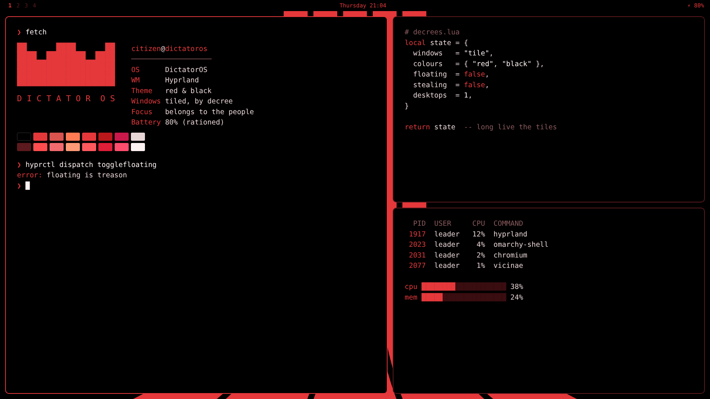

# DictatorOS



> *Citizens of the desktop: the colours of the state are red and black. All other colours
> are confiscated.*

This is the Omarchy theme with the official colours of
[DictatorOS](https://github.com/RuffBudda/DictatorOS).

- Black backgrounds and a solid black bar.
- Red accents on all items, a red terminal palette and red Yaru icons.
- A Chromium with red accents, and a red lock screen.
- Two wallpapers: red stripes that come up from black, and plain black. Use the plain black
  wallpaper if you do not want to see the flag.

## Install

```sh
omarchy theme install dictatoros
```

You can also install it directly from the repository:

```sh
omarchy theme install https://github.com/RuffBudda/omarchy-dictatoros-theme
```

## What it sets

| File | Function |
|---|---|
| `colors.toml` | The full palette: black backgrounds, red accents and a red ANSI palette |
| `shell.toml`, `shell.lock.toml` | The Omarchy shell: a solid black bar with red text, black menus and popups, red borders and a red lock screen |
| `icons.theme` | The `Yaru-red` icons |
| `chromium.theme` | A red Chromium toolbar and red tabs |
| `keyboard.rgb` | A red keyboard backlight on the keyboards that support it |
| `backgrounds/` | Red stripes, and plain black |

The other parts (tiling only, one desktop on all monitors, the minimal lock screen and the
widgets) are in the full [DictatorOS](https://github.com/RuffBudda/DictatorOS) setup.

## License

MIT. Refer to [LICENSE](LICENSE).
