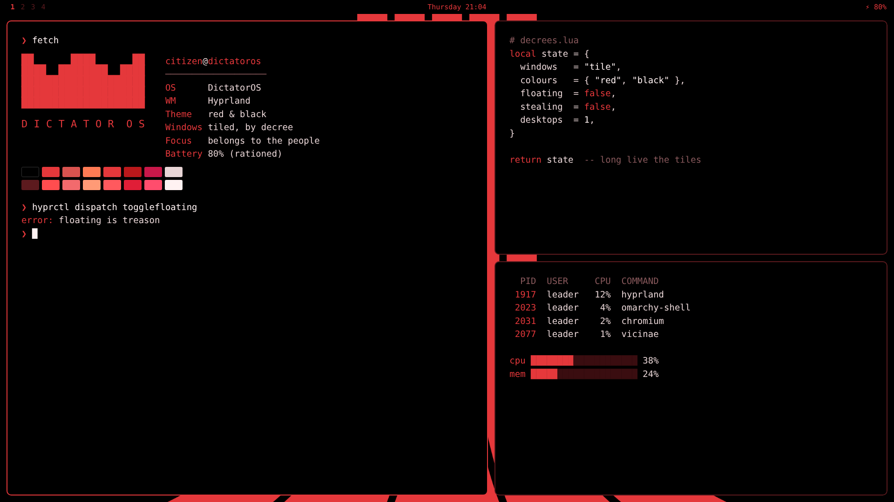

# DictatorOS



> *Citizens of the desktop: the colours of the state are red and black. All other colours
> are confiscated.*

The official colours of [DictatorOS](https://github.com/RuffBudda/DictatorOS), issued as an
Omarchy theme. Black backgrounds, a solid black bar, red accents on everything, a red
terminal palette, red Yaru icons, a red-accented Chromium and a red lock screen. The
wallpaper is red stripes rising from black, plus plain black for citizens who would rather
not look at the flag.

## Install

```sh
omarchy theme install dictatoros
```

Or straight from the repository:

```sh
omarchy theme install https://github.com/RuffBudda/omarchy-dictatoros-theme
```

## What it sets

| File | What it does |
|---|---|
| `colors.toml` | Full palette: black backgrounds, red accents and a red ANSI palette |
| `shell.toml`, `shell.lock.toml` | Omarchy shell: solid black bar with red text, black menus and popups, red borders, red lock screen |
| `icons.theme` | `Yaru-red` icons |
| `chromium.theme` | Red Chromium toolbar and tabs |
| `keyboard.rgb` | Red keyboard backlight on supported keyboards |
| `backgrounds/` | Red stripes, and plain black |

The rest of the regime (tiling only, one desktop across monitors, the minimal lock screen,
widgets) lives in the full [DictatorOS](https://github.com/RuffBudda/DictatorOS) setup.

## License

MIT. See [LICENSE](LICENSE).
